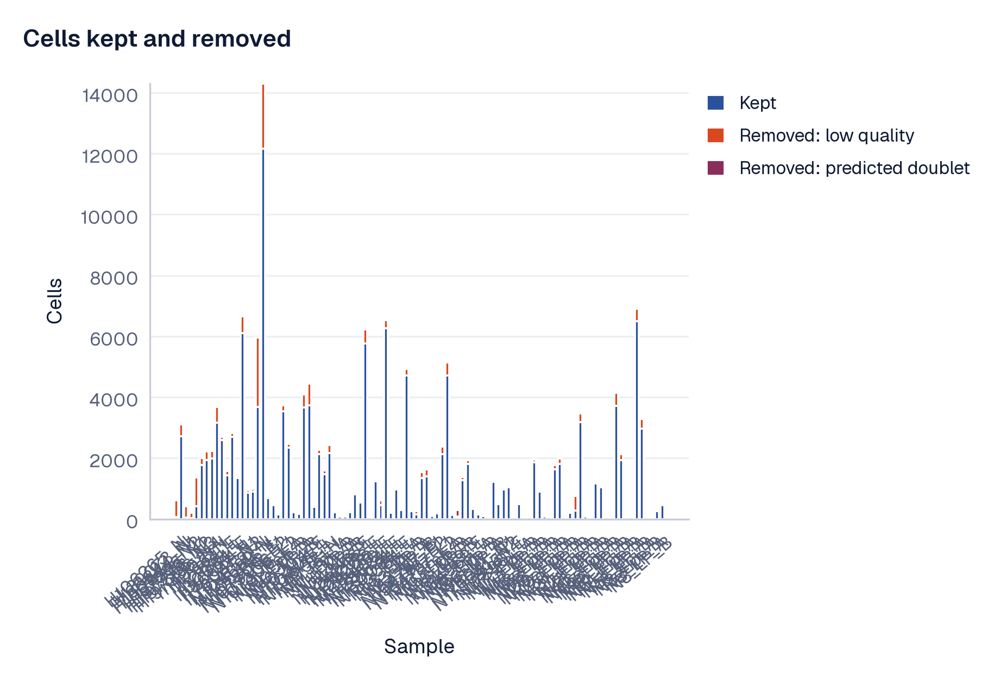
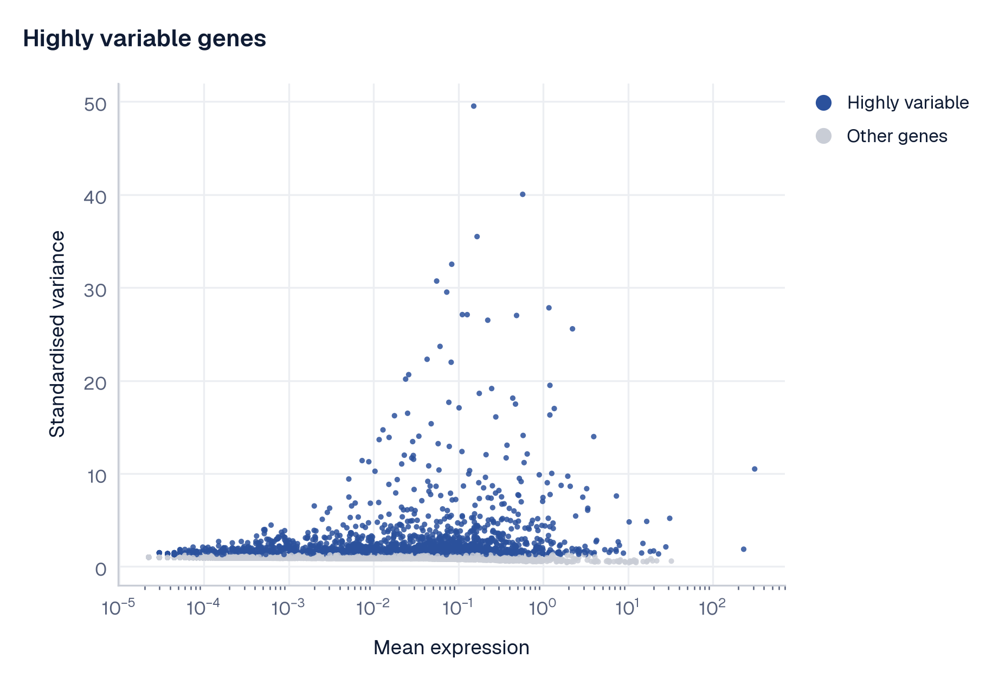
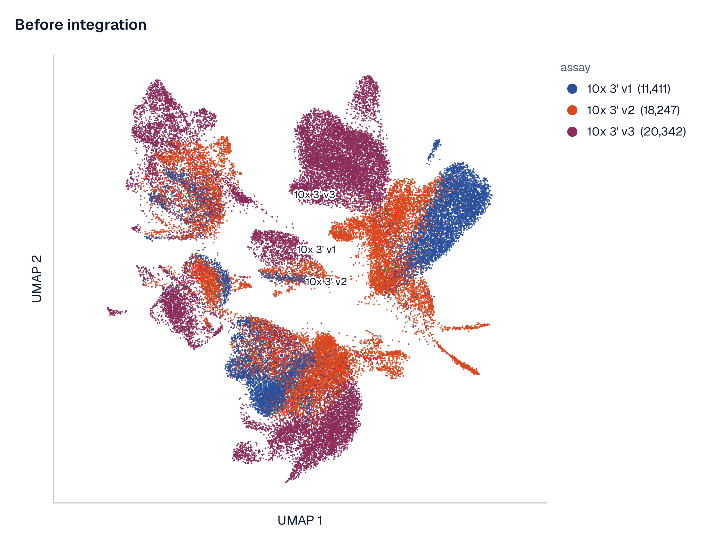
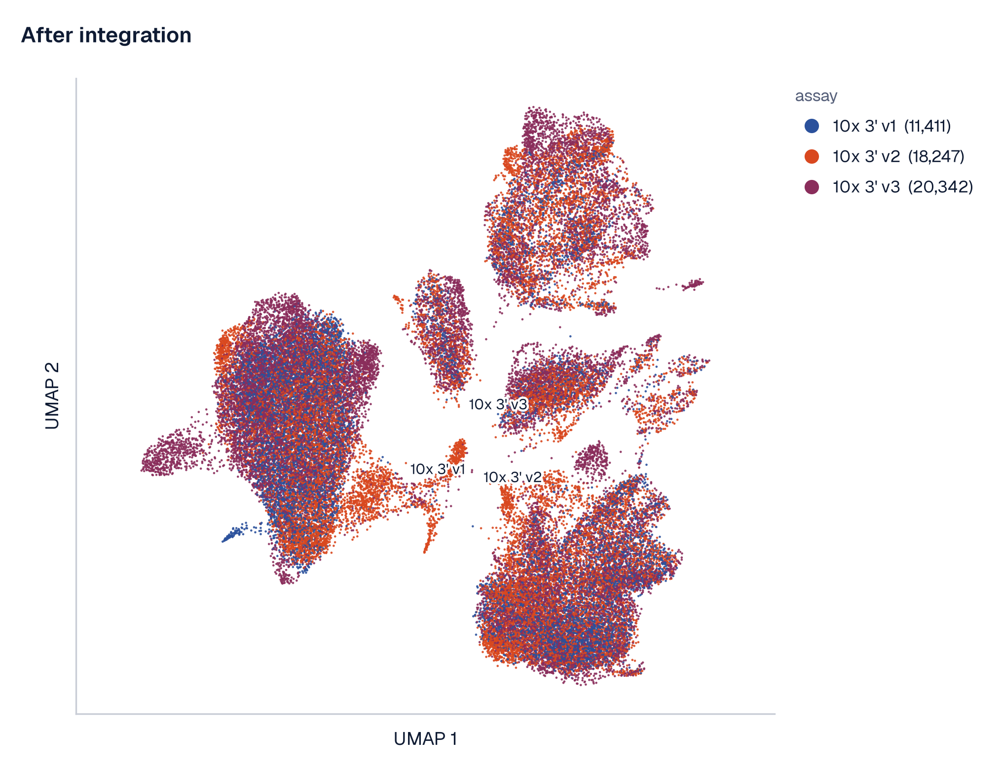
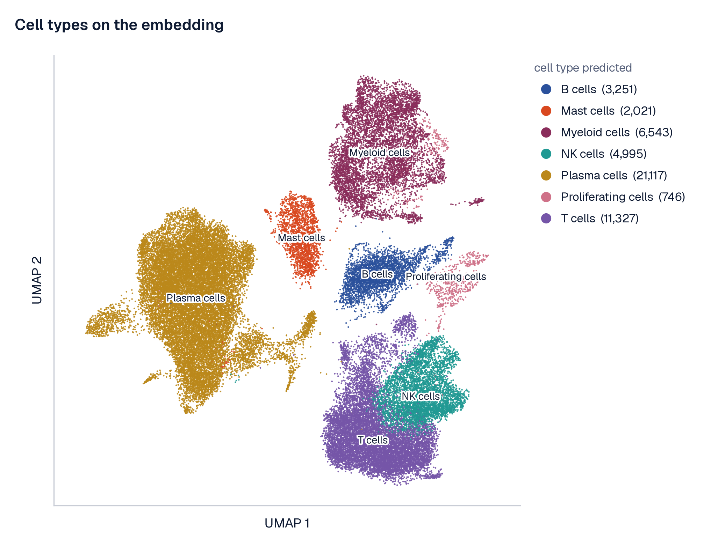
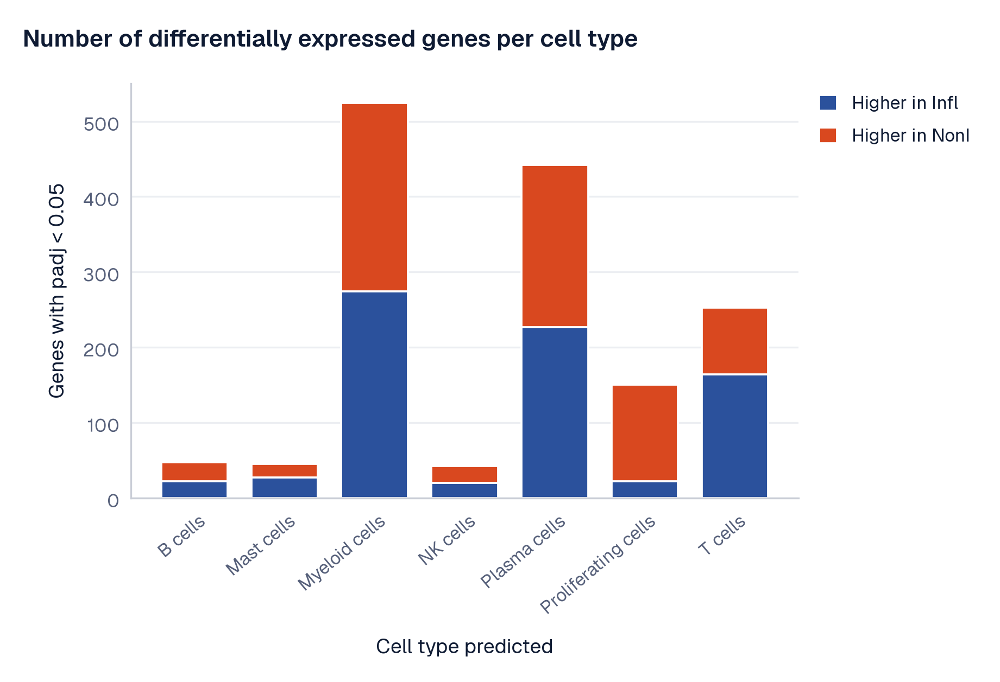
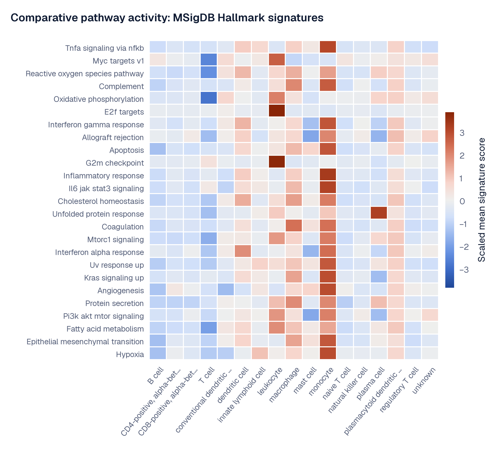
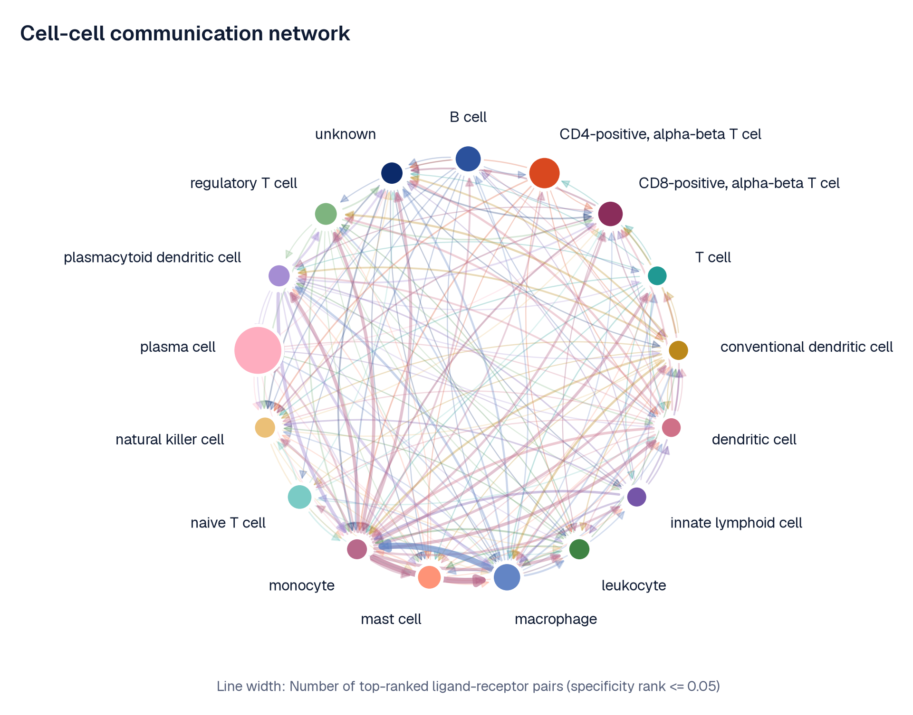
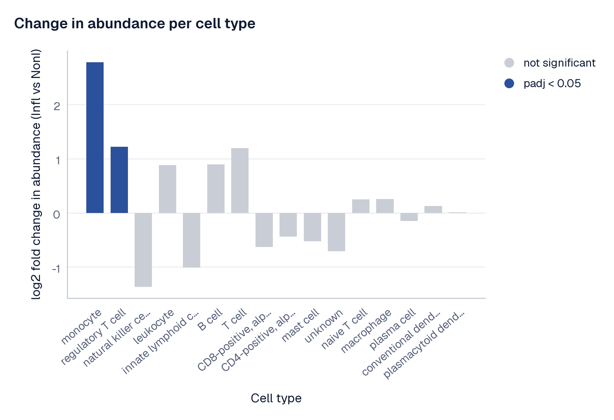
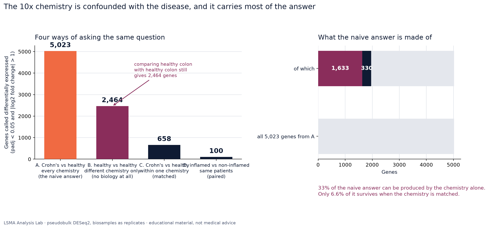

# The inflamed colon, cell by cell: 152,509 cells, and what the controls did to them

A complete single-cell RNA-seq project, run end to end in the **LSMA Analysis Lab** on public data: the immune
compartment of the colon in **Crohn's disease**, 152,509 cells from 34 people, taken through all ten stages of the
lab's `scrna-seq` workflow.

Eight chapters follow the analysis in the order it happened — quality control, normalisation, structure,
batch integration, clusters and cell types, differential expression, pathways, and the advanced modules. Each
chapter carries the lab's own report for that milestone. A ninth section does, outside the lab, the one check the
lab cannot do on itself.

**The result worth reading this repository for is in that last section.** The analysis reaches a conclusion that
looks publishable: thousands of genes separating Crohn's colon from healthy colon. Then the control asks what
happens if you compare healthy colon with healthy colon, changing nothing but the version of the 10x kit. The
answer is 2,464 genes. A third of the disease result is reproducible with no disease in it at all, and only 6.6%
of it survives once the chemistry is matched.

The chemistry was never randomised against the disease. Nothing in the analysis could have told us that, and
nothing in the analysis went wrong.

---

## Contents

| Chapter | Question | Stages | Cells |
|---|---|---|---|
| [1. Quality control](01-quality-control/) | Which barcodes are cells worth keeping? | `import`, `qc` | 152,509 → 133,889 |
| [2. Normalisation and structure](02-structure/) | What varies, and along which axes? | `normalisation`, `dimensionality_reduction` | 133,889 |
| [3. Batch integration](03-integration/) | Can the three 10x chemistries be reconciled? | `integration` | 133,889 |
| [4. Clusters and cell types](04-cell-types/) | What cells are these? | `clustering`, `annotation` | 133,889 |
| [5. Differential expression](05-differential-expression/) | What changes in inflamed tissue? | `differential_expression` | 40 samples |
| [6. Pathways](06-pathways/) | What do those genes mean together? | `interpretation` | 7 cell types |
| [7. Advanced modules](07-advanced/) | Cycle, trajectory, abundance, communication | `advanced` | 133,889 |
| [8. The module that would not fit](#chapter-8--the-module-that-would-not-fit) | What happens when a stage cannot run? | `advanced` / TF activity | — |
| [Validation](validation/) | Is the disease difference the disease? | outside the lab | 84 samples |

Each chapter folder holds the lab's own report (`report/lab-report.pdf` and `.html`), the figures it drew, the
result tables, and `report/run.json` — every parameter, software version and stage summary.

Because the lab writes one report per run, each chapter's report is the report **as it stood when that chapter
finished**. Later chapters' reports therefore contain the earlier chapters' sections too. Nothing is hidden by
this; it is simply how a single cumulative run documents itself.

---

## Introduction: why a large dataset, and why this one

Single-cell RNA-seq is a counting experiment with a visualisation problem attached. Tens of thousands of cells
each give a sparse, noisy vector of gene counts, and almost every published figure is a two-dimensional picture
of that. Pictures are persuasive, and they are the part of the method least able to be wrong in a way you can see.

The lab's previous single-cell worked example used 20,509 cells from 7 patients with kidney cancer. This one uses
**7.4 times as many cells** from **34 people** deliberately, because scale changes which things break. Some
problems only appear with 96 samples of wildly uneven size. Some only appear when a step that is fine on 20,000
cells tries to build a dense matrix of 134,000.

The data are from Kong and colleagues (*Immunity*, 2023), via CZ CELLxGENE Discover, and they are a good choice
for one reason above all: the authors labelled every cell themselves. That gives the automated annotation a real
answer to be scored against, rather than a plausible story to be admired.

The study compares three kinds of tissue: colon from healthy people, colon from Crohn's patients that is **not**
inflamed, and colon from Crohn's patients that is inflamed. That third comparison — inflamed against non-inflamed
in the same disease, sometimes in the same patient — turns out to be the only one the data can support, and
finding that out is most of what this project does.

**This is educational and research material, not medical advice.** Nothing here describes how any patient should
be treated, or what any test result means for any person.

---

## Chapter 1 — Quality control: the average hides the damage

**Method.** 152,509 cells × 26,766 genes arrived as a single H5AD. Thresholds were set per sample rather than
globally: for each of the 96 samples, cells more than 5 median absolute deviations from that sample's median in
counts or genes were removed, more than 3 MADs in mitochondrial fraction, with a hard ceiling of 20% mitochondrial
reads and a floor of 200 genes. Scrublet looked for doublets, per sample.

**Result.** 133,889 cells kept — 17,996 removed as low quality, 624 as doublets, and 4,552 genes dropped for being
seen in fewer than three cells. Median 710 genes and 2,053 counts per cell, median 4.7% mitochondrial.

**12.2% of cells removed. That number is close to meaningless.** Per sample, the same procedure did this:

| Sample | Cells in | Kept | Share | Per-sample gene ceiling |
|---|---|---|---|---|
| `N8_Epi_B` | 1 | 0 | 0% | 108 |
| `H180844_N1` | 424 | 37 | **9%** | 375 |
| `H106265_N` | 620 | 65 | **10%** | 434 |
| `H180844_N2` | 210 | 25 | **12%** | 467 |
| `N15_Epi_B` | 287 | 45 | 16% | 3,032 |
| … | | | | |
| `N8_LP_B` | 479 | 463 | 97% | 11,467 |

Seven samples lost more than half their cells; three lost about 90%; one ended with none. The per-sample ceiling
on detected genes ranged from **108 to 132,062** — a factor of 1,200. That is the MAD rule behaving exactly as
defined and still being the wrong rule for a shallow sample, because a sample whose own median is low gets a
threshold that cuts into its own middle.

**What the controls and the lab's own warnings did to it.** Three things, all of which the lab said out loud:

- **Scrublet was skipped for 22 of 96 samples**, each having fewer than 100 cells. So 624 doublets is a floor,
  not an estimate, and the samples most likely to be odd are the ones left unchecked.
- **Ambient RNA was not assessed at all.** The lab states why: SoupX and CellBender need the unfiltered droplet
  matrix alongside the filtered one, and CELLxGENE distributes only one matrix.
- **The lab flagged that this looks like an unfiltered matrix** still containing empty droplets, and said plainly
  that proper cell calling upstream (Cell Ranger's filtered output, EmptyDrops, CellBender) would be better than
  letting QC thresholds stand in for it. With a median of 1,808 counts per barcode, that warning is credible.

So chapter 1's honest summary is not "12.2% removed". It is: the filtering worked as specified, three samples were
effectively destroyed by it, a fifth of the samples were never checked for doublets, and the matrix should have
been cell-called before any of this began.

---

## Chapter 2 — Normalisation and structure: the most variable genes are not biology

**Method.** Counts normalised to 10,000 per cell and log-transformed; 2,000 highly variable genes by the Seurat v3
variance-stabilising method; scaled, clipped at 10 standard deviations; 50 principal components computed, 30 used;
a 15-nearest-neighbour graph and a UMAP.

**Result.** The 30 components used explain **22.6%** of the variance — low, and normal for single-cell data, where
most of the variance is sampling noise. UMAP trustworthiness was **0.961**, meaning 96% of each cell's UMAP
neighbours are genuinely its neighbours in the component space the UMAP was built from. t-SNE was switched off at
this size.

**What the controls did to it.** Two findings, neither flattering:

- **The ten most variable genes are mostly not biology.** They are `HBB`, `MT1G`, `CXCL9`, `MT1M`, `HBA2`,
  `PTGDS`, `MT1X`, `MT1H`, `CXCL10`, `MT1E`. Two are haemoglobin — red blood cells, or their RNA leaking into
  other droplets. Five are metallothioneins, which cells switch on under stress, including the stress of being
  dissociated from tissue. Only `CXCL9` and `CXCL10` are plausibly the interferon response anyone studying Crohn's
  would want. **Nothing was regressed out**, so these genes helped define every component, every neighbour and
  every cluster downstream.
- **Per-sample variable-gene selection was silently disabled.** The parameter was set to `true` and the lab
  reported `hvg_selected_per_sample: false`. The reason is in the lab's code: it requires *every* sample to have
  at least 50 cells before it will select genes per sample. One sample — `N8_Epi_B`, with a single cell — failed
  that test, and so variable genes were chosen once across all 133,889 cells instead. A single cell changed the
  feature selection for the entire dataset. The lab reported the outcome truthfully and did not report the cause;
  that is logged as a defect below.

---

## Chapter 3 — Batch integration: it worked, and it could not possibly help

**Method.** Harmony on the principal components, with the 10x chemistry (`assay`: 3' v1, v2 and v3) as the batch
and the authors' own cell labels as the quality measure.

**Result: on its own terms, a clear success.**

| Measure | Before | After |
|---|---|---|
| Batch mixing in the neighbourhood graph | 0.163 | **0.581** |
| Batch silhouette (lower is better) | −0.051 | **−0.091** |
| Cell-type silhouette (higher is better) | 0.121 | **0.157** |
| Clusters made almost entirely of one chemistry | 17 | **4** |

Chemistry structure went down, biological structure went up, and the number of clusters that were really just one
chemistry fell from 17 to 4. Cluster membership changed substantially in the process (agreement with the
pre-integration clustering, adjusted Rand index 0.42), which is what integration is for.

**What the control did to it: the whole exercise is beside the point, and the lab says so in its own note.**
Integration changes the embedding used for clustering and drawing pictures. It does not change counts. Every
statistical test in this project — all of chapter 5, all of chapter 6 — uses raw counts summed per sample.

So integration makes the UMAP look as though the chemistry problem has been dealt with, while leaving that problem
completely intact everywhere a *p*-value is computed. The [validation section](#validation-the-chemistry-is-the-experiment)
measures what it left behind: 2,464 genes separating healthy colon from healthy colon.

A well-mixed UMAP after integration is not evidence that a confound has been handled. It is evidence that the
embedding has been adjusted.

---

## Chapter 4 — Clusters and cell types: 25 clusters, 7 labels, and the cytotoxic cells in the wrong box

**Method.** Leiden clustering at resolution 0.8 on the integrated embedding; Wilcoxon rank-sum markers for each
cluster against all other cells; then marker-panel scoring per cluster to assign cell types. The lab chose the
panel itself.

**Result.** 25 clusters, from 21,825 cells down to 39. Silhouette 0.092 — low, and appropriate: this is one
immune compartment with continuous variation, not a set of separated islands. The lab chose its **"Major tissue
lineages"** panel automatically, reasoning in writing that the tissue is not blood, and collapsed the 25 clusters
into **7 cell types**: Plasma cells (56,606), T cells (30,427), Myeloid cells (17,650), NK cells (13,206), B cells
(8,571), Mast cells (5,396), Proliferating cells (2,033).

The authors of the data assigned **25** labels to the same cells. The coincidence of 25 clusters and 25 author
labels means nothing, as the control shows.

**What the controls did to it.** The authors' labels were never shown to the lab, so they are a real test. Scored
outside the lab ([`validation/scripts/label_agreement.py`](validation/scripts/label_agreement.py)):

| Compared with the authors' 25 labels | Adjusted Rand index | Mean purity |
|---|---|---|
| The lab's 7 cell types | **0.801** | **0.949** |
| The lab's 25 Leiden clusters | 0.316 | 0.573 |
| CELLxGENE's 17-label ontology | 0.962 | 1.000 |

Three things follow, and they pull in different directions:

- **The annotation is good.** 0.801 against labels it never saw, with 94.9% of cells in the modal pairing of their
  author label, is a real result for an automated method using a generic panel.
- **The clusters are not the cell types.** 25 clusters against 25 author labels agree at only 0.316. The clustering
  did not recover the authors' categories; the *scoring step afterwards* recovered the coarse lineages. Matching
  cluster counts told us nothing, which is worth remembering every time a resolution is tuned until the number
  "looks right".
- **One of the two label sets is not an independent check.** CELLxGENE's 17 labels score 0.962 with purity of
  exactly **1.000**. A purity of exactly 1 means every author label falls entirely inside one ontology label: it
  is a deterministic re-coding of the authors' own work, not a second opinion. Treating it as independent
  corroboration — which is tempting, since it ships in the same file — would have been wrong.

**And the specific failure.** From the lab's own agreement table:

| The authors called them | Cells | The lab called them |
|---|---|---|
| CD4-positive αβ T cell | 18,047 | T cells (90%) ✅ |
| **CD8-positive αβ T cell** | **8,177** | **NK cells (81%)** ❌ |
| Natural killer cell | 1,976 | NK cells (88%) ✅ |
| Plasmacytoid dendritic cell | 3,296 | Myeloid cells (99%) |
| Plasma cell | 61,742 | Plasma cells (99%) ✅ |

**6,664 of 8,177 cytotoxic T cells were labelled NK cells.** This is not a random error and not a bug. CD8 T cells
and NK cells both kill, and they do it with the same proteins — `GNLY`, `NKG7`, `GZMB`, `PRF1`. A panel scoring
cytotoxic markers will put cytotoxic T cells in the NK bin, and it will do so with a confident-looking score. The
lab marked that cluster's confidence as only "medium", which is the honest signal it could give; nothing in the
automated output says "these are the wrong cells".

Everything downstream inherits this. The "NK cells" row of chapter 5 is mostly CD8 T cells.

---

## Chapter 5 — Differential expression: the one comparison the data can support

**Method.** Pseudobulk: raw counts summed within each sample × cell type, then DESeq2 with samples as the
replicates, Wald test, apeglm shrinkage. The contrast is **inflamed against non-inflamed Crohn's tissue** —
8 samples against 32 — grouped by the lab's own 7 cell types, with the 10x chemistry as a covariate
(`~ assay + Type`).

This is the right comparison, and it is right for a reason worth stating. Inflamed and non-inflamed tissue both
span chemistries v2 and v3 and neither includes v1, so chemistry is estimable rather than confounded. The obvious
comparison — Crohn's against healthy — could not be done honestly, and the validation section shows what happens
when it is done anyway.

**Result.** Genes with adjusted *p* below 0.05:

| Cell type | Significant genes |
|---|---|
| Myeloid cells | 524 |
| Plasma cells | 442 |
| T cells | 253 |
| Proliferating cells | 150 |
| B cells | 47 |
| Mast cells | 45 |
| NK cells | 42 |

**What the design does to it.** Three qualifications, none of which the numbers above carry on their face:

- **No cells were treated as replicates.** 133,889 cells became 40 pseudobulk profiles. That is the whole point:
  testing cells as replicates would report thousands of genes from a handful of patients, because cells from one
  person are not independent samples of the disease. The lab does not offer that test at all.
- **8 against 32 is a small, unbalanced comparison.** The inflamed arm is 5 donors. These counts are what 5 people
  can support, and no amount of cells changes that.
- **The "NK cells" row is mostly CD8 T cells**, per chapter 4. Its 42 genes are real; its label is not.

---

## Chapter 6 — Pathways: where ORA and GSEA disagree, and why

**Method.** Over-representation analysis on the significant genes, and GSEA on the full ranked list, against MSigDB
Hallmark and GO Biological Process; plus Hallmark signature scoring on individual cells.

**Result.** The two methods disagree sharply, by design:

| Cell type | ORA sets | GSEA sets |
|---|---|---|
| Myeloid cells | 119 | 426 |
| NK cells | **233** | 138 |
| Plasma cells | 16 | 277 |
| Proliferating cells | 20 | 478 |
| T cells | 72 | 93 |
| B cells | 2 | 78 |
| **Mast cells** | **0** | **217** |

Mast cells are the instructive row: 45 significant genes gave **zero** enriched sets by ORA and **217** by GSEA.
That is not a contradiction. ORA asks whether a hard list of winners is unusually full of a category, and 45 genes
is too few to be unusual. GSEA ignores the threshold and asks whether a category sits high in the whole ranking,
which can detect a consistent small shift across hundreds of genes. When a cell type has few significant genes and
many enriched sets, the enrichment is describing a gentle, broad tilt — which may be real, and is not the same
claim as "these genes changed".

The most variable Hallmark signatures across cells were TNFα signalling via NF-κB, MYC targets, reactive oxygen
species, complement, and oxidative phosphorylation — an inflammatory and metabolic picture consistent with the
tissue, and consistent with a great many other tissues too.

**A gap worth naming.** The lab drew its per-cell-type enrichment figures for one group (B cells) plus the global
signature heatmap. The result tables cover all seven cell types; the figures do not.

---

## Chapter 7 — Advanced modules: what four of them found

Four modules ran on all 133,889 cells. The fifth is chapter 8.

**Cell cycle.** 30.7% of cells scored as S or G2/M. For a tissue immune compartment that is implausibly high as
biology, and the lab states the assumption that makes it readable: the scores are relative within this dataset,
and a "G1" call only means neither gene set is elevated. Given chapter 2 — metallothionein stress genes among the
most variable — a dissociation-stress contribution is the more likely reading than a colon in which three cells in
ten are dividing.

**Differential abundance.** edgeR quasi-likelihood F-test on cell counts per sample, inflamed against non-inflamed,
8 against 32. Of 16 cell types, **two** changed significantly:

| Cell type | log2 fold change | Adjusted *p* |
|---|---|---|
| Monocyte | **+2.78** | 0.000011 |
| Regulatory T cell | **+1.22** | 0.012 |

A nearly sevenfold rise in monocytes in inflamed tissue, with regulatory T cells also up. This is the most robust
biological finding in the project, it is what is already known about inflamed Crohn's mucosa, and it does not
depend on the chemistry confound: both arms span the same two chemistries. Fourteen cell types showed nothing.
The lab also notes that proportions are compositional — a rise in one type mechanically lowers the share of the
others — so "monocytes up" and "NK cells down" (log2 −1.36, adjusted *p* 0.082, not significant) are not two
findings.

**Trajectory.** PAGA connectivity across 17 groups, 68 edges above threshold. **No pseudotime was computed.** The
lab refused, because no root population was specified and pseudotime requires a biologically justified starting
point. That refusal is correct and worth dwelling on: this is a mature immune compartment, not a differentiation
hierarchy, and a pseudotime through plasma cells, mast cells and monocytes would have been a number with no
meaning. A tool that declines to produce output is doing something useful.

**Cell communication.** LIANA rank aggregate — a consensus of CellPhoneDB, Connectome, log2FC, NATMI and
SingleCellSignalR — over 14,860 ligand–receptor pairs, 1,101 top-ranked.

**And the control on that is unkind.** The top-ranked interactions are `HLA-B` → `CD3D` and `B2M` → `KLRD1`,
repeated across source cell types. `HLA-B` and `B2M` are MHC class I components: among the most highly expressed
genes in every nucleated cell in the body. A method ranking by co-expression magnitude ranks them first because
they are abundant, not because they are the signalling that matters here. Worse, the single most frequent *target*
among the top hits is the cell type the authors could not identify, labelled `unknown`. The top of this list is a
statement about abundance and about an unlabelled cluster, not about Crohn's disease. The lab's own stated
assumption is the right warning: co-expression of a ligand and a receptor does not show that signalling occurs —
protein levels, proximity and activity are not measured.

---

## Chapter 8 — The module that would not fit

Transcription-factor activity did not run. It is reported here rather than dropped.

**What happened.** Run on all 133,889 cells it was killed by the kernel after 16.1 minutes, out of memory, with
24 GB available to the worker. Run on a random subsample of 50,000 cells it held 15 GB for over 50 minutes without
finishing and was cancelled. No TF activity results exist in this project.

**Why.** `decoupler` scores curated regulons against an expression matrix, and the step zero-centres it, which
turns a sparse matrix dense. Dense, this matrix is

$$133{,}889 \times 22{,}214 \times 8 \text{ bytes} = 23.8 \text{ GB}$$

for a single copy, and the operation holds more than one. The dataset is not too large in any interesting sense;
one step simply stops exploiting the sparsity that makes single-cell data tractable.

**What this cost, measured.** Each module was then run on its own, which is how the picture above was established:

| Module | On all 133,889 cells | Time |
|---|---|---|
| Cell cycle | ✅ completed | 2.5 min |
| Differential abundance | ✅ completed | 1.5 min |
| Trajectory | ✅ completed | 1.5 min |
| Cell communication (LIANA) | ✅ completed | 3.0 min |
| **TF activity** | ❌ **out of memory** | 16.1 min to die |

Two things to take from that table. Four of five modules handle 134,000 cells comfortably on an ordinary machine,
so "the dataset is too big" was the wrong diagnosis. And LIANA, which failed in the first combined attempt,
succeeds on its own — the combined stage runs every module in one process and does not release memory between
them, so a set of modules that each fit can fail together. Both points are logged as defects below.

The honest conclusion is narrow and useful: on 24 GB, this lab runs every advanced module on 134,000 cells except
transcription-factor activity, which needs roughly 60 GB or a change to how it is computed.

---

## Validation: the chemistry is the experiment

Chapters 5 and 6 compared inflamed with non-inflamed tissue, and avoided the comparison everyone actually wants:
Crohn's against healthy. This section does it anyway, and then checks it — outside the lab, as a plain script
([`validation/scripts/chemistry_confound.py`](validation/scripts/chemistry_confound.py)) using the same pseudobulk
DESeq2 method, with the 84 biosamples that have at least 50 cells as replicates.

**The problem, in one table.** The study used three versions of the 10x chemistry, and not evenly:

| Tissue | 3' v1 | 3' v2 | 3' v3 | Donors |
|---|---|---|---|---|
| Healthy | 34,631 | 28,942 | **0** | 16 |
| Crohn's, non-inflamed | **0** | 24,884 | 43,234 | 17 |
| Crohn's, inflamed | **0** | 5,636 | 15,182 | 5 |

**v1 was used only on healthy colon. v3 only on Crohn's colon.** Only v2 spans both. So "healthy versus Crohn's"
is also "v1 versus v3", and no statistical adjustment can separate two things that never vary independently.

**Four comparisons, each checking the others:**

| | Comparison | Samples | Genes called |
|---|---|---|---|
| **A** | Crohn's vs healthy, every chemistry — *the naive answer* | 45 vs 39 | **5,023** |
| **B** | Healthy vs healthy, v1 vs v2 — *no biology whatsoever* | 33 vs 12 | **2,464** |
| **C** | Crohn's vs healthy, within v2 only — *chemistry matched* | 12 vs 8 | **658** |
| **D** | Inflamed vs non-inflamed, same patients — *paired* | 6 vs 6 | **100** |

**B is the comparison that matters.** Both sides are healthy colon from healthy people. The only difference is
which version of a kit was used. It yields **2,464 genes at adjusted *p* < 0.05 with more than a twofold change**.
Not noise, not borderline — a large, confident, entirely artefactual gene list.

**And A is made largely of B.** Of the naive answer's 5,023 genes:

- **1,633 (32.5%)** are also called by the chemistry-only comparison. A third of the "disease signature" is a
  signature of kit version.
- **Only 330 (6.6%)** survive when the comparison is repeated within a single chemistry.

Matching the chemistry costs almost all of the apparent result: 5,023 genes become 658, and 93% of the original
list does not reappear.

**D is the trustworthy answer, and it is small.** Four donors — `114902`, `117351`, `130084`, `175041` — gave both
an inflamed and a non-inflamed sample. Comparing those within patient, with the donor in the model, removes the
chemistry confound and between-person variation at a stroke. It gives **100 genes** from 12 samples.

That is the shape of the whole project. The design that can be trusted is the one with the least data in it, and
it returns 2% of what the design that cannot be trusted returned. A reader shown only A would have seen thousands
of genes and a clean story.

**What this does not say.** It does not say the dataset is bad — it is a careful, well-labelled study, and its
authors did not do the naive comparison. It does not say there is no difference between Crohn's and healthy colon;
there certainly is. It says this dataset cannot measure it, and that the analysis cannot tell you so. Only the
metadata can, and only if someone cross-tabulates the batch against the condition before starting.

**Two further curation problems**, found while setting this up and worth knowing for anyone using the same file:

- **CELLxGENE's `disease` column is wrong for 68,118 cells.** It marks only the 20,818 inflamed cells as "Crohn
  disease" and calls the 68,118 **non-inflamed Crohn's** cells "normal". Group by `disease` and you compare Crohn's
  tissue with Crohn's tissue while believing you have a disease contrast. The authors' `Type` column is correct and
  is what this project used throughout.
- **51,345 of 63,573 healthy cells are not primary to this study** (`is_primary_data = False`) — a healthy cohort
  borrowed from another dataset, and exactly the cells with no age recorded. Only 12,228 healthy cells originate
  here. They were kept, because dropping them would leave almost no healthy arm, but any analysis weighting
  healthy against Crohn's is weighting one cohort against another.

---

## The mathematics

Every formula below is one this project actually used.

**Per-sample quality thresholds.** For a metric $`x`$ within one sample, with $`\mathrm{med}`$ the median,

$$\mathrm{MAD} = \mathrm{med}\left( \left| x_i - \mathrm{med}(x) \right| \right)$$

and a cell is removed when $`\left| x_i - \mathrm{med}(x) \right| > k \cdot \mathrm{MAD}`$, with $`k = 5`$ for
counts and genes and $`k = 3`$ for mitochondrial fraction. Because $`\mathrm{med}`$ and $`\mathrm{MAD}`$ are
computed per sample, a shallow sample gets a tight threshold — which is the mechanism behind chapter 1's table.

**Mitochondrial fraction**, per cell, over the mitochondrial gene set $`M`$:

$$\mathrm{pct\_mt}_i = 100 \times \frac{\sum_{g \in M} c_{ig}}{\sum_{g} c_{ig}}$$

**Doublet score.** Scrublet simulates doublets by adding pairs of observed cells, then scores each real cell by the
share of simulated doublets among its $`k`$ nearest neighbours in the combined data,

$$s_i = \frac{k_i^{\mathrm{sim}}}{k_i^{\mathrm{sim}} + k_i^{\mathrm{obs}}}$$

adjusted for the expected doublet rate. It needs enough cells to simulate from, which is why it was skipped for
the 22 samples with fewer than 100.

**Normalisation.** Each cell's counts are scaled to a common total $`T = 10{,}000`$ and log-transformed:

$$y_{ig} = \log\left(1 + T \cdot \frac{c_{ig}}{\sum_h c_{ih}}\right)$$

The $`1+`$ keeps zeros at zero, and the per-cell rescaling is what makes cells of different depth comparable —
imperfectly, since it assumes depth affects all genes alike.

**Variable genes.** The Seurat v3 method fits the relationship between a gene's mean and its variance across cells,
then ranks genes by *standardised* variance — observed variance divided by the variance the fit expects at that
mean. This is why abundant genes such as `HBB` can still rank first: they vary more than even their high mean
predicts.

**Principal components.** The scaled matrix $`X`$ is decomposed so that component $`j`$ explains

$$\frac{\lambda_j}{\sum_{l} \lambda_l}$$

of the total variance, with $`\lambda_j`$ the eigenvalues of the covariance matrix. The 30 components used here sum
to 0.226.

**UMAP trustworthiness.** For each cell, the share of its $`k`$ nearest neighbours in the embedding that are also
among its $`k`$ nearest in the original space, averaged over cells:

$$T = 1 - \frac{2}{nk(2n - 3k - 1)} \sum_{i=1}^{n} \sum_{j \in N_i^{\mathrm{emb}}} \left( r_{ij} - k \right)$$

where $`r_{ij}`$ is the rank of cell $`j`$ among $`i`$'s neighbours in the original space. It reached 0.961, which
says the picture preserves local neighbourhoods — and says nothing about distances between distant groups, which is
the part of a UMAP people read anyway.

**Harmony.** Iteratively soft-assigns cells to clusters and then removes, within each cluster, the mean difference
between batches, minimising an objective that rewards batch-mixed clusters while penalising cells being moved far:

$$\min \sum_{i,k} q_{ki} \lVert z_i - c_k \rVert^2 + \sigma \sum_{i,k} q_{ki} \log q_{ki} + \sigma \theta \sum_{k,b} q_{kb} \log \frac{q_{kb}}{q_k p_b}$$

The last term is the entropy penalty that pushes each cluster's batch composition towards the dataset's overall
composition $`p_b`$. **Crucially, $`z_i`$ is a coordinate, not a count.** Harmony corrects positions; it cannot
correct a comparison.

**Batch mixing.** For each cell, the share of its neighbours from a different batch, averaged, with 1 meaning
neighbours are drawn as though batch were irrelevant. It went from 0.163 to 0.581.

**Silhouette.** For a cell $`i`$ with mean distance $`a_i`$ to its own group and $`b_i`$ to the nearest other group,

$$s_i = \frac{b_i - a_i}{\max(a_i, b_i)}$$

Averaged over cells, this is high when groups separate. Used twice, with opposite intent: low is good for batch,
high is good for cell type.

**Leiden clustering** maximises modularity, the excess of within-cluster edges over what degree alone would give:

$$Q = \frac{1}{2m} \sum_{i,j} \left( A_{ij} - \gamma \frac{k_i k_j}{2m} \right) \delta(c_i, c_j)$$

with $`A`$ the neighbour graph, $`k_i`$ a cell's degree, $`m`$ the edge count, and $`\gamma`$ the resolution — 0.8
here. The resolution is a choice, not a property of the data, and it sets how many clusters appear.

**Cluster markers.** The Wilcoxon rank-sum statistic, cluster against all other cells,

$$U = R_1 - \frac{n_1(n_1 + 1)}{2}$$

with $`R_1`$ the rank sum of the cluster's cells. The lab labels these *p*-values exploratory, and it is right to:
the clusters were defined from the same expression data, so the test is being asked whether groups chosen for
being different are different.

**Marker-panel scoring.** A cluster's score for a cell type is the mean expression of that type's markers minus
the mean of a reference set of genes matched for expression level:

$$\mathrm{score} = \frac{1}{|G|}\sum_{g \in G} y_g - \frac{1}{|R|}\sum_{g \in R} y_g$$

The subtraction is what stops highly expressed marker sets winning automatically. It cannot help when two cell
types genuinely share their markers, which is why 81% of CD8 T cells were called NK cells.

**Agreement between two labellings.** The adjusted Rand index counts agreeing pairs of cells, corrected for the
agreement expected by chance:

$$\mathrm{ARI} = \frac{\sum_{ij} \binom{n_{ij}}{2} - \left[ \sum_i \binom{a_i}{2} \sum_j \binom{b_j}{2} \right] / \binom{n}{2}}{\frac{1}{2}\left[ \sum_i \binom{a_i}{2} + \sum_j \binom{b_j}{2} \right] - \left[ \sum_i \binom{a_i}{2} \sum_j \binom{b_j}{2} \right] / \binom{n}{2}}$$

and normalised mutual information measures shared information rather than shared pairs:

$$\mathrm{NMI}(U,V) = \frac{2 I(U;V)}{H(U) + H(V)}$$

ARI is the stricter of the two when one labelling is much coarser, which is why the lab's 7 labels score 0.801 by
ARI and 0.714 by NMI against 25.

**Pseudobulk.** Counts are summed, not averaged, within each sample $`s`$ and cell type $`t`$:

$$K_{stg} = \sum_{i \in (s,t)} c_{ig}$$

Summing keeps the result a count, so a count-based model applies, and it makes the sample the unit of replication.

**DESeq2.** Counts are modelled as negative binomial with a gene-specific dispersion:

$$K_{sg} \sim \mathrm{NB}\left( \mu_{sg}, \alpha_g \right), \qquad \log_2 \mu_{sg} = \log_2 q_{sg} + \log_2 f_s$$

where $`f_s`$ is the sample's size factor and $`\log_2 q_{sg}`$ is the linear model — here
$`\sim \mathrm{assay} + \mathrm{Type}`$. The negative binomial is used rather than Poisson because biological
replicates vary more than counting alone allows: its variance is

$$\mathrm{Var} = \mu + \alpha \mu^2$$

Coefficients are tested by a Wald statistic $`\beta / \mathrm{se}(\beta)`$ and shrunk with apeglm, which pulls
poorly estimated fold changes towards zero.

**Many tests at once.** Benjamini–Hochberg, with *p*-values sorted $`p_1 \le \dots \le p_m`$, rejects every
hypothesis up to

$$k = \max \left\lbrace i : p_i \le \frac{i}{m}\alpha \right\rbrace$$

which controls the expected share of false positives among those called, at $`\alpha = 0.05`$ throughout.

**Differential abundance.** edgeR's quasi-likelihood F-test on cell counts per sample, which adds a second
dispersion estimate to account for uncertainty in the first; the statistic compares nested models as

$$F = \frac{(D_0 - D_1)/(p_1 - p_0)}{D_1 / (n - p_1)}$$

with $`D`$ the residual deviances. Applied to counts of cells, so the response is composition and all proportions
are coupled.

**Over-representation.** The hypergeometric probability of seeing at least $`k`$ of a gene set $`K`$ among $`n`$
significant genes drawn from $`N`$ tested:

$$P(X \ge k) = \sum_{x=k}^{\min(n,K)} \frac{\binom{K}{x}\binom{N-K}{n-x}}{\binom{N}{n}}$$

Everything here depends on the threshold that defines "significant", which is why Mast cells returned nothing.

**GSEA.** No threshold: genes are ranked, and the enrichment score is the largest deviation of a running sum that
rises on set members and falls on non-members,

$$\mathrm{ES} = \max_{j} \left| \sum_{i \le j, g_i \in S} \frac{|r_i|^p}{N_R} - \sum_{i \le j, g_i \notin S} \frac{1}{N - |S|} \right|$$

with $`N_R = \sum_{g_i \in S} |r_i|^p`$. Because it reads the whole ranking, it can find the broad gentle shifts
that gave Mast cells 217 sets from 45 significant genes.

**Cell-cycle score.** The same reference-subtracted mean as marker scoring, computed over 41 S-phase and 54 G2/M
genes; a cell is called G1 when neither score is elevated, which lumps non-cycling cells with cells whose phase is
simply unclear.

**Cell communication.** LIANA combines five scoring methods by robust rank aggregation: for an interaction ranked
$`r_1 \dots r_5`$ by the five methods, each rank is normalised to $`(0,1]`$ and the probability of seeing a
collection of ranks that good by chance is computed from the order statistics of the uniform distribution,

$$p_{\mathrm{RRA}} = \min_{k} \beta_{k,5}\left(r_{(k)}\right)$$

where $`\beta_{k,5}`$ is the Beta distribution of the $`k`$-th smallest of 5 uniforms. CellPhoneDB's own *p*-value
is instead a permutation test: cell labels are shuffled and the mean of the ligand and receptor means recomputed,

$$p = \frac{\left| \lbrace b : \bar{m}_b \ge \bar{m}_{\mathrm{obs}} \rbrace \right|}{B}$$

Neither accounts for a ligand being ubiquitous, which is how MHC class I reached the top of the list.

**PAGA connectivity** between clusters $`a`$ and $`b`$ compares the edges actually running between them with the
number expected if the graph's edges were placed at random given each cluster's size and degree; edges above 0.05
are drawn. It is a statement about graph structure, not about development.

**The lab's memory estimate**, which is how chapter 8 was predicted and then mispredicted:

$$\mathrm{GB} \approx 1.5 + n_{\mathrm{cells}} \times 1.2 \times 10^{-4}$$

giving 19.8 GB for 152,509 cells. Four of five advanced modules fit inside that. TF activity needs the dense
matrix, $`n_{\mathrm{cells}} \times n_{\mathrm{genes}} \times 8`$ bytes, which is 23.8 GB for one copy — so the
formula is roughly 2.5 times too small for that module, and the run was allowed to start.

---

## Limitations

- **The chemistry is confounded with the disease.** This is the project's main finding and its main limitation.
  Nothing in this repository should be read as measuring a difference between Crohn's and healthy colon. The
  inflamed-versus-non-inflamed comparisons are sound; the disease-versus-healthy comparisons are not, and are
  included only to show what they look like.
- **The matrix was never cell-called.** The lab said so. Empty droplets were removed by QC thresholds rather than
  by a method designed for the job, and ambient RNA was not estimated at all, because the unfiltered matrix is not
  distributed.
- **Technical genes drove the analysis.** Haemoglobin and metallothioneins are among the most variable genes and
  nothing was regressed out, so they influenced components, neighbours and clusters throughout.
- **Per-sample variable-gene selection never happened**, disabled by one sample containing one cell.
- **Three samples lost around 90% of their cells** to per-sample thresholds, and 22 samples were never checked for
  doublets.
- **81% of CD8 T cells are in the "NK cells" group.** Every per-cell-type result inherits that, including chapter
  5's and chapter 6's "NK cells" rows.
- **7 cell types, not 25.** The automated panel is coarser than the authors' labels by design, so macrophage
  subsets, dendritic subsets, monocytes, Tregs and the CD4/CD8 split are invisible to chapters 5 to 7.
- **Transcription-factor activity has no results**, at 134,000 cells or at 50,000.
- **No pseudotime**, by the lab's deliberate refusal, and correctly.
- **The top communication hits are abundance artefacts**, and the most frequent target is an unidentified cell type.
- **The inflamed arm is 5 donors and 8 samples.** Every *p*-value in chapters 5 to 7 rests on that.
- **This is the immune compartment only.** Epithelium and stroma are barely represented despite the tissue labels,
  so nothing here describes the epithelial barrier that Crohn's disease is substantially about.
- **One dataset, one disease.** None of this establishes how these methods behave in general — only how they
  behaved here, where the authors' labels gave us something to check against.

---

## Reproducing this

Every chapter was run in the LSMA Analysis Lab from public data, with no private inputs. Workflow `scrna-seq`
version 1.0.0, seed 42. `report/run.json` in each chapter records every parameter, stage summary and software
version: Python 3.12.16, Scanpy 1.12.5, AnnData 0.13.4, NumPy 2.5.4, SciPy 1.18.1, pandas 2.3.3,
scikit-learn 1.9.1, Scrublet, harmonypy 2.1.0, leidenalg, umap-learn, LIANA 2.1.1, and R 4.5.2 with DESeq2 1.48.2,
edgeR 4.6.3, apeglm 1.30.0, clusterProfiler 4.16.0, fgsea 1.34.2 and msigdbr 26.1.1.

The validation section runs outside the lab, on the lab's own annotated object, with PyDESeq2 0.5.4. Its scripts
are in [`validation/scripts/`](validation/scripts/) and its outputs beside them.

Two tables that are too large for a repository were left out and are reproducible from the recorded parameters:
the per-cell QC table (13.6 MB), the per-cell embedding coordinates (18.9 MB) and the per-cell annotations
(9.6 MB).

**Defects found in the lab while running this project**, all reported upstream:

- the memory estimate does not account for the advanced modules that densify the matrix, so a run that cannot
  complete passes the pre-flight check and is allowed to start;
- the advanced stage runs every module in one process without releasing memory between them, so a set of modules
  that each fit can fail together — LIANA failed in combination and succeeded alone;
- per-sample variable-gene selection is disabled for the whole dataset if *any* sample has fewer than 50 cells,
  and the reported outcome does not name the cause;
- a sample can lose almost all its cells to per-sample thresholds without a warning naming that sample.

Finding those is part of what a worked project is for.

---

## Related projects

Part of the LSMA Analysis Lab showcase series:

- **[Single cell — kidney cancer](https://github.com/MultiOmics-Intelligence/lsma-lab-single-cell-kidney-cancer-ccrcc)** — the same workflow on 20,509 cells, validated against the authors' labels
- **[Drug discovery — lung adenocarcinoma](https://github.com/MultiOmics-Intelligence/lsma-lab-drug-discovery-lung-adenocarcinoma)** — four routes to one target, and four controls that changed the answer
- **[Full multi-omics project — lung adenocarcinoma](https://github.com/MultiOmics-Intelligence/lsma-lab-full-project-lung-adenocarcinoma)** — one question through six modules
- **[All LSMA Analysis Lab projects](https://github.com/orgs/MultiOmics-Intelligence/repositories?q=lsma-lab)** — one worked example per lab module

---

London School of Multiomics & AI — Analysis Lab. Educational and research material. Not medical advice, and
not a description of how any patient should be treated. Public data only: CZ CELLxGENE Discover, dataset
`518d9049-2a76-44f8-8abc-1e2b59ab5ba1`, from Kong et al., *Immunity* 2023 (doi:10.1016/j.immuni.2023.01.002);
gene sets from MSigDB.
